# 基于 SpringBoot + 微信小程序的图片识别科普系统的设计与实现

> 本文围绕图片识别与科普知识结合的应用场景，设计并实现了一个基于 SpringBoot + 微信小程序的图片识别科普系统。

## 一、项目背景

随着移动互联网和人工智能技术的普及，用户对动植物识别与科普知识获取的需求日益增长。传统的科普方式依赖人工讲解或图文手册，效率低且不便携。本项目通过微信小程序接入图片识别能力，用户可快速识别动植物并查看详细科普信息，同时支持文章阅读、每日答题等互动功能，有效提升了科普教育的趣味性和可及性。系统同时为管理员提供后台管理模块，支持对用户、知识库、文章、题目等内容的统一维护。

## 二、功能模块介绍

系统分为两个端：用户端（微信小程序）和管理后台（PC网页）。

| 角色 | 所属端 |
|------|--------|
| 用户 | 微信小程序 |
| 管理员 | 管理后台 |

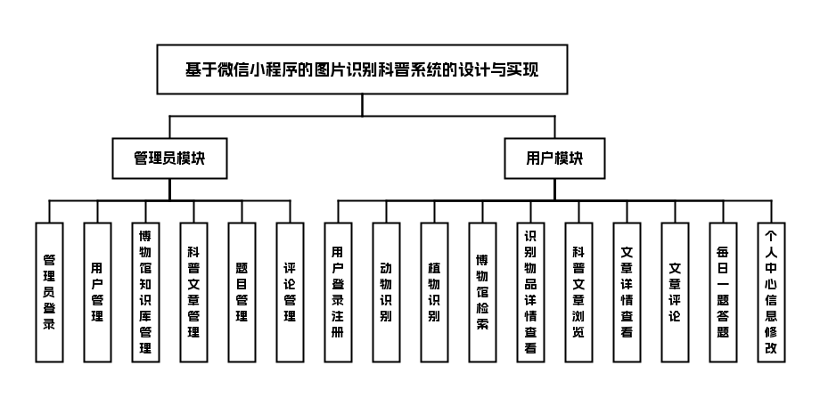

## 三、技术栈说明

前端：Vue + 微信小程序

后端：SpringBoot + JAVA

数据库与中间件：MySQL

## 四、核心模块介绍

###### 微信小程序端

###### 用户

- 用户登录注册
- 首页：动物识别，植物识别
- 博物馆：用户识别之后保存到数据库，可以通过名称或者分类（动物，植物）等进行检索
- 识别物品详情：识别之后查看具体详细信息
- 科普文章
- 文章详情
- 文章评论
- 每日一题：选择题，然后可以下一题上一题等
- 个人中心：个人信息修改等

##### 界面展示

注册页：填写账号密码，完成小程序账号注册

登录页：输入账号密码，登录图片识别小程序

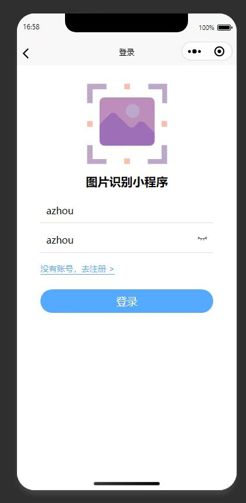

植物识别页：上传植物图片提交，完成植物识别

识别物品详情页：展示识别得到的月季花的科普百科详情

科普文章列表页：展示哺乳动物分类下的科普文章列表

列表页：展示已保存的识别物种，支持分类检索

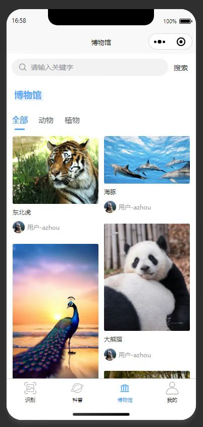

文章详情页：展示哺乳动物科普内容，支持用户评论

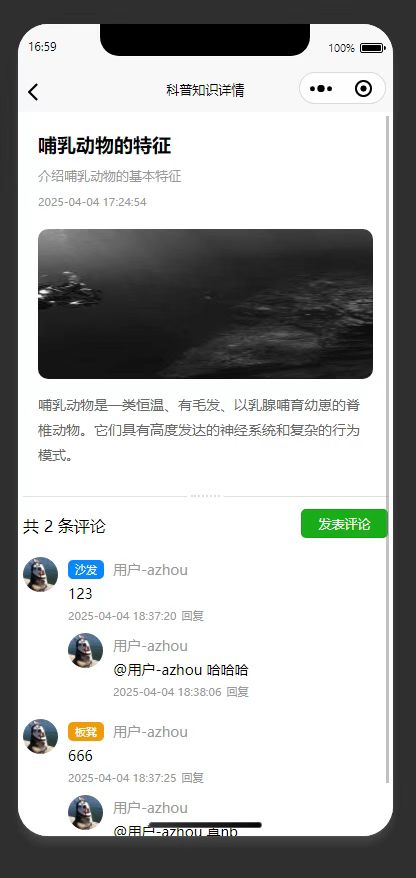

每日一题页：展示每日科普选择题，支持切换上下题

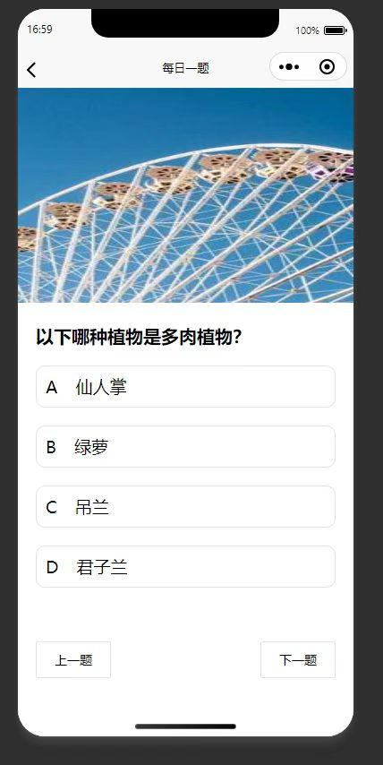

识别记录列表页：展示用户识别历史，支持筛选搜索识别记录

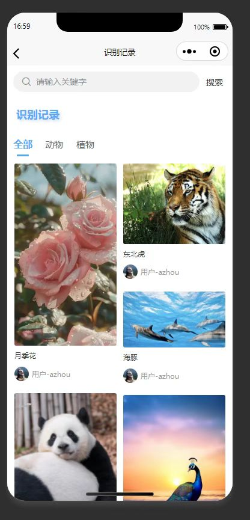

首页：展示各识别功能入口，可跳转对应功能

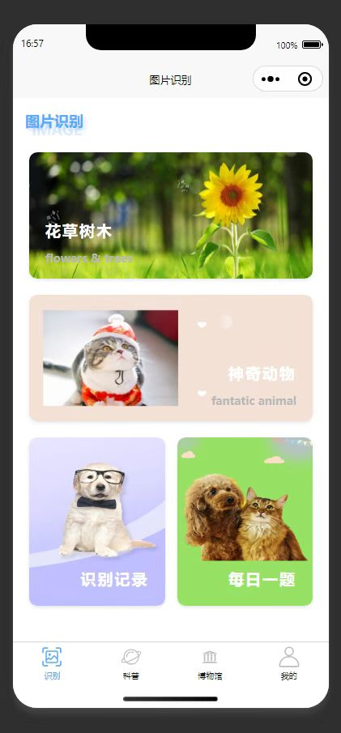

个人中心页：展示个人中心功能，可修改信息修改密码退出登录

修改密码页：输入新旧密码，完成个人账号密码修改

###### 管理后台

###### 管理员

- 管理员登录
- 用户管理
- 博物馆知识库管理
- 科普文章管理
- 题目管理
- 评论管理

##### 界面展示

登录页：管理员输入账号密码登录图片识别后台

用户管理页：展示系统用户列表，支持对用户进行管理操作

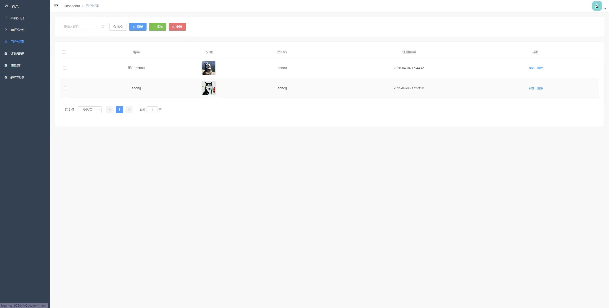

知识分类管理页：管理科普知识分类，支持增删改操作

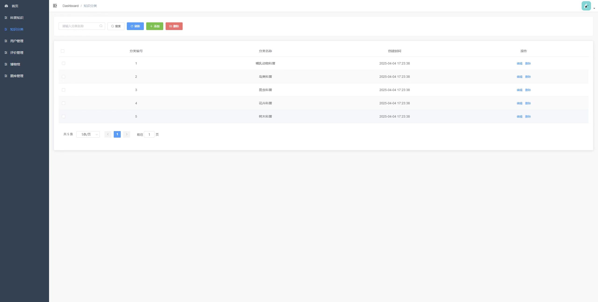

博物馆知识库管理页：管理员管理博物馆知识库的科普物种条目

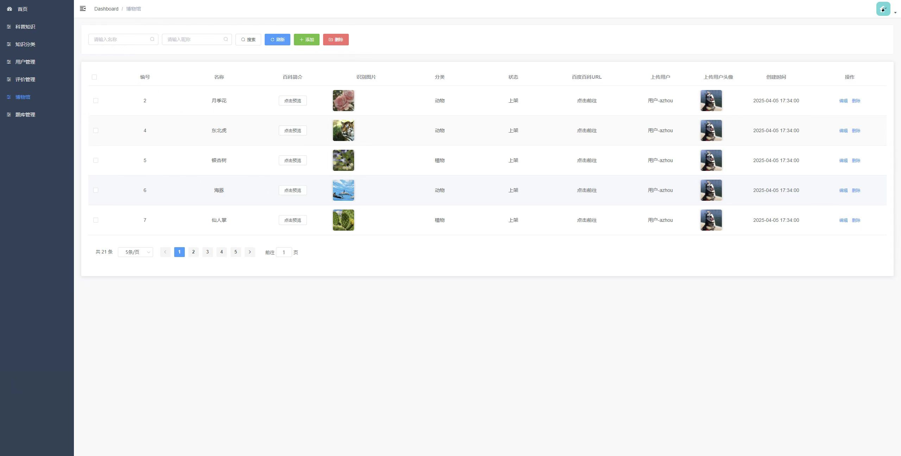

博物馆知识库管理：修改博物馆知识库的科普条目信息

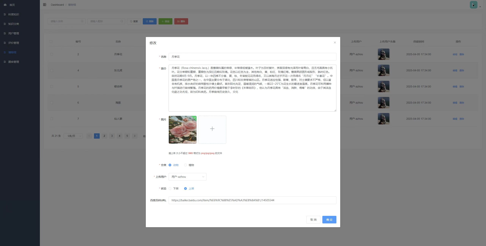

科普文章管理：管理科普知识，支持搜索增删改操作

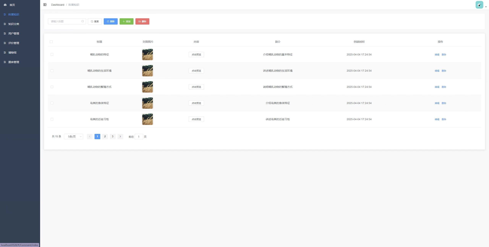

科普文章管理：编辑修改哺乳动物科普文章的相关信息

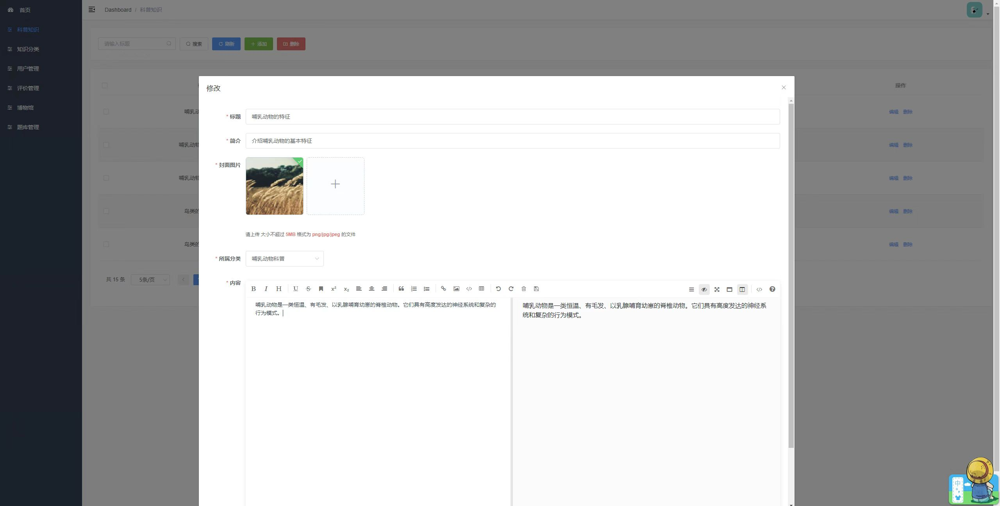

题库管理页：展示题目列表，可对题目进行增删改操作

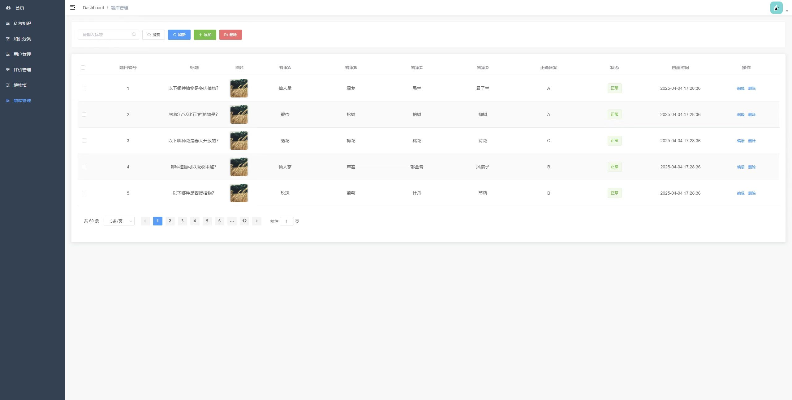

评价管理页：管理员查看和删除用户对科普内容的评价

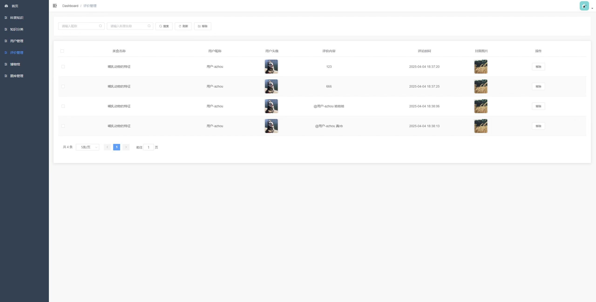

## 五、主要业务流程

1. 用户在微信小程序中打开首页，选择动物识别或植物识别
2. 用户拍摄或上传图片，系统调用识别接口返回识别结果
3. 用户查看识别物品详情，系统自动将识别记录保存至博物馆
4. 用户可在博物馆中按名称或分类检索历史识别记录
5. 用户可浏览科普文章、查看文章详情并发表评论
6. 用户可在每日一题模块中答题，支持上一题和下一题切换
7. 用户在个人中心可修改个人信息
8. 管理员登录管理后台，对用户、博物馆知识库、科普文章、题目、评论进行管理

## 六、项目拓展性

未来可增加语音识别、视频科普、AR展示等功能，进一步提升用户体验。同时可接入更多图片识别模型，扩展识别范围至昆虫、矿物、建筑等类别。后台可增加数据分析模块，对用户识别行为和答题数据进行统计分析，辅助科普内容优化。

## 代码说明 
本仓库为项目的 **后端核心代码部分** 主要用于展示系统的业务设计思路与后端实现方式 出于学习展示与版权保护考虑 前端实现、完整数据库脚本及部署配置未在本仓库中公开 

##  项目交流 
本项目用于学习展示 如需项目完整功能演示、答辩说明或技术交流 请前往作者 GitHub 主页查看联系方式